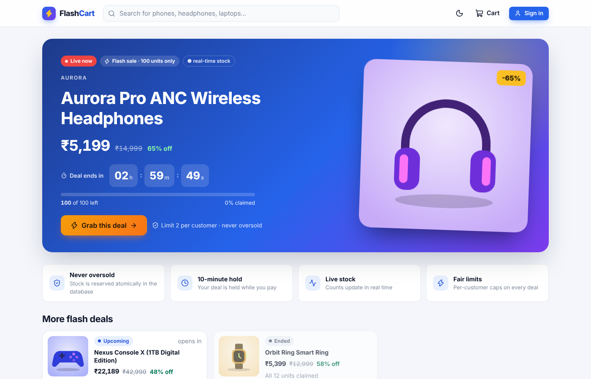
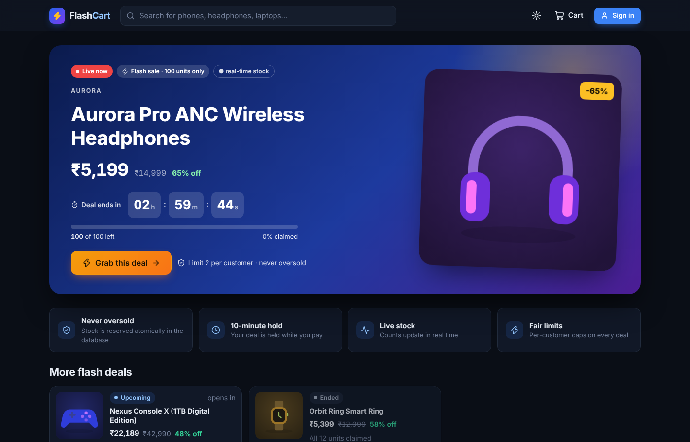
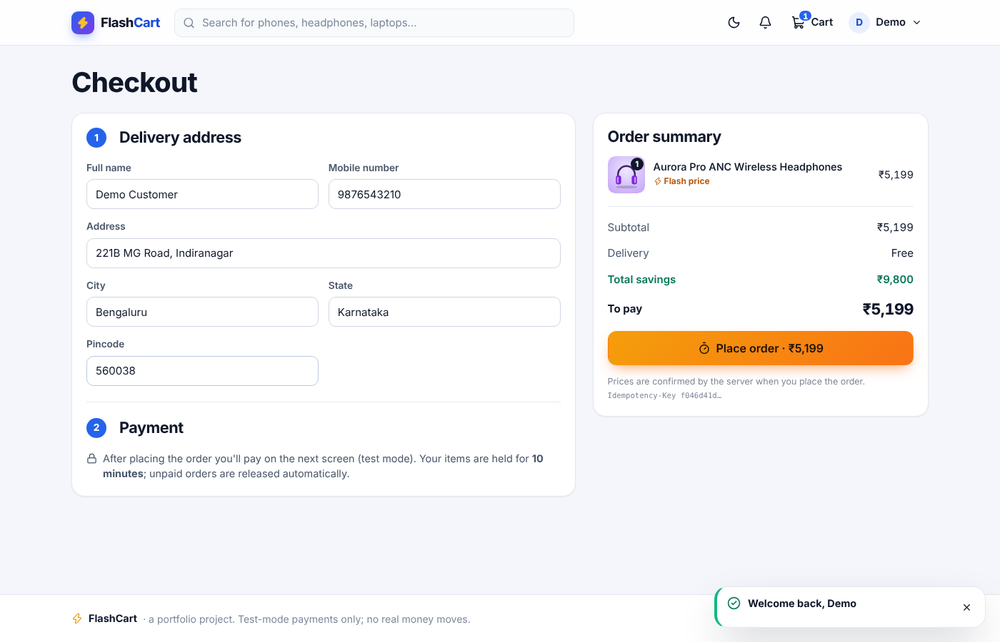
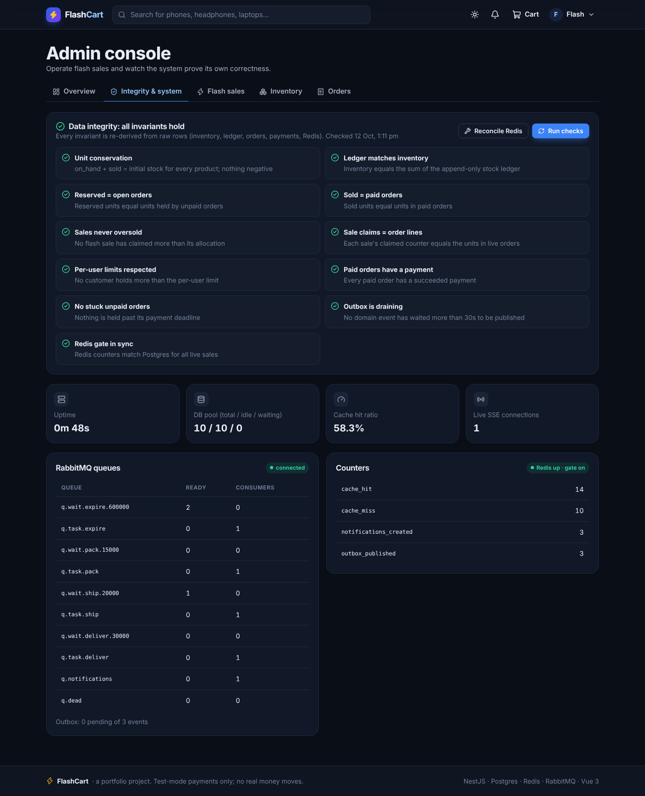
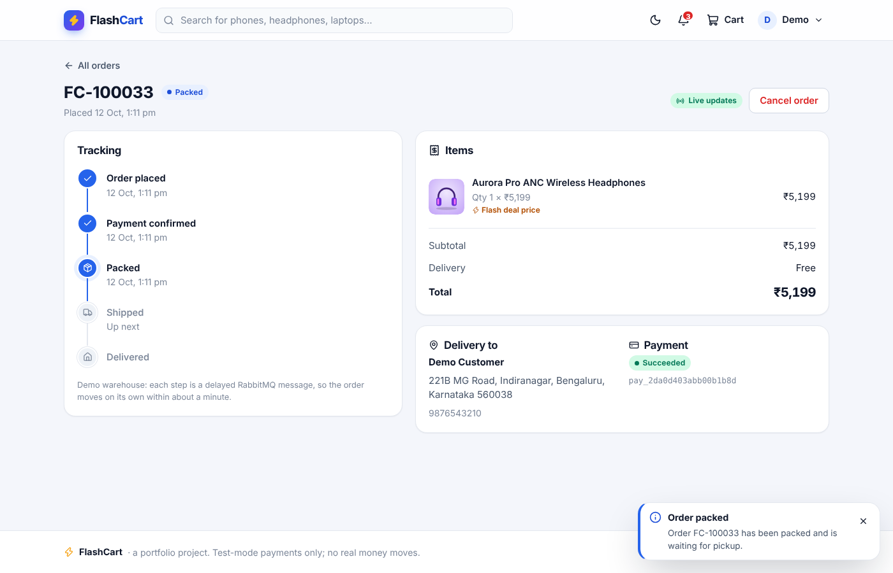
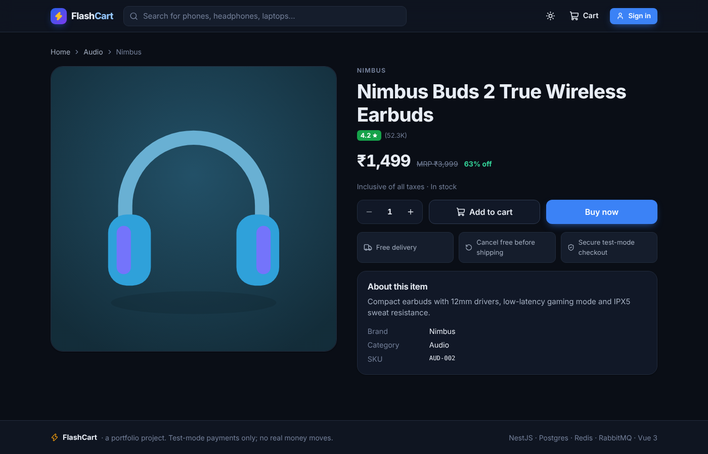
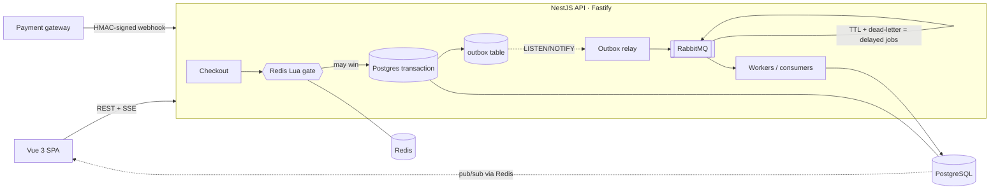

# FlashCart: a flash-sale e-commerce system that never oversells

FlashCart is a Flipkart-style storefront built around one hard problem: **thousands of people clicking "Buy" on 100 units at the same second**. Every one of them must get a correct answer quickly, and the shop must never sell unit 101, never charge twice, and never lose an order.

It has a full shopping flow: catalogue, search, cart, checkout, test-mode payments, live order tracking and an admin console. Underneath is the engineering that makes the flow safe under load:

- atomic stock reservation enforced by Postgres constraints
- a Redis Lua gate that absorbs the stampede
- idempotent checkout
- a transactional outbox to RabbitMQ
- durable delayed jobs for expiry and fulfilment
- HMAC-verified payment webhooks
- an explicit order state machine
- real-time updates over Server-Sent Events
- an admin page that re-proves every invariant from raw data

**Stack:** NestJS 11 (TypeScript, Fastify) · PostgreSQL 16 · Redis 7 · RabbitMQ 3 · Vue 3 + TypeScript + Pinia + Vite · Jest · k6 · Docker · GitHub Actions

| Light | Dark |
|---|---|
|  |  |
|  |  |
|  |  |

More screenshots (mobile, payment, admin) are in [`docs/screenshots`](docs/screenshots).

---

## Measured results

All numbers below were measured, not estimated. **Hardware:** a single cloud VM with **2 vCPUs** (Intel Xeon @ 2.8 GHz) and 8 GB RAM. The API (one Node.js process), Postgres, Redis, RabbitMQ *and the k6 load generator* all ran on that same machine, so they competed for the same two cores. Treat the latencies as a floor for this tiny box, not as a production figure.

**Correctness under concurrency: Jest integration tests** against real Postgres, Redis and RabbitMQ (30 tests, all passing):

| Scenario | Result |
|---|---|
| 120 concurrent buyers, 20-unit sale (Redis gate on) | exactly **20** orders, 100 × `409 SOLD_OUT` |
| Same, with the Redis gate **disabled** (Postgres alone) | exactly **20** orders |
| One user firing 12 parallel requests, limit 2 | exactly **2** orders, 10 × `LIMIT_REACHED` |
| 40 buyers, 7 units of regular stock | exactly **7** orders |
| 20 parallel requests with the same `Idempotency-Key` | **1** order (1 × 201, 19 × 200 replay) |
| Unpaid order past its deadline | expired by a RabbitMQ delay queue; stock and sale units returned |
| Payment webhook arriving after expiry | payment **refunded**, order stays expired, nothing shipped |
| Duplicate webhook / duplicate queue delivery | processed once (dedupe tables) |

**Load test (k6)** — a flash-sale stampede: N users each try to buy 1 of 100 units within ~1.5 s, while 150 req/s of browsing traffic runs in parallel. After each run, [`loadtest/verify.js`](loadtest/verify.js) checks the database directly.

| Run | Orders created | Sold-out replies | Errors | Checkout p50 / p95 | Browse p95 | Books balance |
|---|---|---|---|---|---|---|
| 1,000 users · Redis gate **on** | **100** | 900 | 0 | 2.6 s / 2.9 s | 0.7 s | ✅ all checks |
| 1,000 users · gate **off** (Postgres only) | **100** | 900 | 0 | 6.2 s / 8.1 s | 2.7 s | ✅ all checks |
| 3,000 users · gate on | **100** | 2,599 | 301 timeouts | saturated | saturated | ✅ no oversell |

The takeaways:

- **Correctness never depended on load.** Every run sold exactly the allocation.
- **The Redis gate cut checkout p95 by ~2.8×.** It rejects the 90% who cannot win before they touch Postgres.
- **3,000 simultaneous connections are beyond this 2-vCPU box.** That includes the load generator running on the same machine. Requests timed out, but even then nothing was oversold or double-counted.

Full method and raw output: [`docs/LOADTEST.md`](docs/LOADTEST.md).

---

## Architecture



How a flash-sale purchase flows:

1. **Rate limit.** A Redis token bucket runs per IP and per user. Abusive clients get `429` with `Retry-After`.
2. **Idempotency.** The client sends an `Idempotency-Key`. A retry with the same key returns the original order, never a second one.
3. **Server-side pricing.** The browser's prices are ignored. Sale price, shipping and totals are computed on the server.
4. **Redis gate.** One Lua script atomically checks the remaining units and the per-user limit, then decrements both. Most of the crowd is rejected here in microseconds.
5. **Postgres, the source of truth.** One transaction inserts the order, then claims stock with *conditional* updates (`... WHERE claimed + q <= quantity`). `CHECK` constraints make overselling impossible even if application code were wrong. Rows are touched in product-id order to avoid deadlocks. If anything fails, the gate is given back.
6. **Outbox.** `order.created` is written in the *same* transaction. A relay publishes it to RabbitMQ after commit, so there are no lost events and no phantom events.
7. **Delayed jobs.** `order.created` lands in a queue with a 10-minute TTL that dead-letters into `task.expire`. If the order is still unpaid then, it expires and its stock is released. A periodic sweeper is the backstop.
8. **Payment.** Only an HMAC-signed, timestamped, de-duplicated webhook can mark an order paid. The order row is locked before the payment row (one global lock order). Late money for an expired order is refunded automatically.
9. **Fulfilment.** `order.paid` → `PACKED` → `SHIPPED` → `DELIVERED`, each step a delayed message, and each step validated by the state machine.
10. **Realtime.** State changes go through Redis pub/sub to every API instance. Instances push them to browsers over SSE: live stock bars, order timelines and notifications.

Deeper write-up of each decision and its trade-offs: [`docs/ENGINEERING.md`](docs/ENGINEERING.md).

---

## Features

**Shopper:**

- flash-sale hero with a server-clock-synced countdown and a live stock bar
- catalogue with full-text search (Postgres `tsvector`), category filters and sorting
- product pages and a persistent cart drawer
- validated checkout and a test-mode payment screen (success or declined card)
- live order tracking timeline, order history and in-app notifications
- light/dark theme (follows the OS, remembers your choice, no flash on load)
- responsive down to 360 px, keyboard accessible, reduced-motion aware

**Admin** (sign in with the demo admin account):

- revenue and order KPIs
- live flash-sale progress
- schedule new flash sales; the API rejects overlapping sales and sales bigger than available stock
- restock inventory
- browse all orders
- **integrity & system panel**, which recomputes 11 invariants from raw rows: unit conservation, ledger = inventory, reserved = unpaid orders, sold = paid orders, never oversold, per-user limits, Redis gate vs Postgres drift, and more
- system panel with RabbitMQ queue depths, outbox lag, cache hit ratio, DB pool, live SSE connections, and one-click Redis reconciliation

---

## Run it locally

**Option A: Docker (one command)**

```bash
docker compose up --build
# shop:          http://localhost:8081
# API:           http://localhost:8080/api/health
# RabbitMQ UI:   http://localhost:15672  (guest / guest)
```

**Option B: without Docker** (needs Node 22+, Postgres 16, Redis 7 and RabbitMQ 3 running locally)

```bash
# Postgres: create a role and database "flashcart" (password "flashcart"), plus "flashcart_test" for tests
cd api && npm ci && npm run build && npm start      # migrates + seeds on first start, :8080
cd web && npm ci && npm run dev                     # :5173, proxies /api to :8080
```

**Demo accounts** (the login page has one-click buttons):

| Role | Email | Password |
|---|---|---|
| Shopper | `demo@flashcart.dev` | `demo12345` |
| Admin | `admin@flashcart.dev` | `admin12345` |

The seed creates 24 products from fictional brands, about 32 historical orders and an ended, sold-out sale. It always keeps one live and one upcoming flash sale running, so the demo never goes stale.

**Tests and load tests:**

```bash
cd api && npm test                                   # 30 integration tests (needs the flashcart_test DB)
# load test: API started with RATE_LIMIT_ENABLED=false so k6's single IP isn't throttled
node loadtest/prepare.js 1000 100                    # 1,000 users with JWTs, a 100-unit sale
USERS=1000 k6 run loadtest/flash-sale.js
node loadtest/verify.js                              # proves sold <= stock straight from the database
```

> The Dockerfiles and `docker-compose.yml` were written for this repo but could not be executed in the environment where it was built (no Docker daemon). Everything else above was run and verified there. If `compose` needs a tweak on your machine, the services and environment variables in the file are the complete list.

---

## Deploy (free tiers)

| Piece | Service | Notes |
|---|---|---|
| API | Render (Docker, `render.yaml`) | free instances sleep when idle; first request takes ~30 s |
| Postgres | Neon | use `?sslmode=require` in `DATABASE_URL` |
| Redis | Upstash | `rediss://` URL; the free command quota is enough for a demo, not a load test |
| RabbitMQ | CloudAMQP (Little Lemur) | `amqps://` URL |
| Frontend | Vercel | root `web/`, set `VITE_API_URL` to the Render URL; `vercel.json` handles SPA routes |

On the API, set `NODE_ENV=production`, `JWT_SECRET` (32+ chars), `WEBHOOK_SECRET` and `CORS_ALLOWED_ORIGINS=<your Vercel URL>`. The API refuses to start in production without real secrets.

---

## API overview

Errors use a problem-JSON shape: `{ status, code, title, detail, ... }`.

| Method & path | Auth | Purpose |
|---|---|---|
| `POST /api/auth/register` · `/login` · `GET /me` | – / – / user | accounts (bcrypt, JWT) |
| `GET /api/products?q=&category=&sort=&page=` | – | catalogue + live availability |
| `GET /api/products/:id` · `GET /api/categories` | – | |
| `GET /api/flash-sales` | – | sales + `serverNow` for clock sync |
| `POST /api/orders` (header `Idempotency-Key`) | user | checkout → `201`, or `200` + `Idempotent-Replayed` |
| `GET /api/orders` · `/:id` · `POST /:id/cancel` | user | history, detail with timeline, cancel (refunds if paid) |
| `POST /api/orders/:id/payments` | user | start a payment attempt |
| `POST /api/gateway/pay` | user | test-mode gateway simulator |
| `POST /api/payments/webhook` (header `x-signature`) | HMAC | the only way an order becomes paid |
| `GET /api/stream/sales/:id` · `/api/stream/me` | – / user | Server-Sent Events |
| `GET /api/notifications` · `POST /read-all` | user | in-app notifications |
| `GET /api/admin/stats` · `/integrity` · `/system` · `/products` · `/orders` | admin | console |
| `POST /api/admin/flash-sales` · `/products/:id/restock` · `/reconcile-gates` | admin | operations |
| `GET /api/health` | – | readiness: `503` only if Postgres is down |

---

## Project structure

```
api/                     NestJS backend
  src/db/migrations/     schema: every invariant is a constraint
  src/orders/            checkout, state machine, atomic stock operations
  src/payments/          payment attempts, HMAC webhooks, gateway simulator
  src/sales/             flash sales + Redis gate
  src/workers/           outbox relay, queue consumers, expiry sweeper, notifications
  src/events/            SSE hub (Redis pub/sub fan-out)
  src/admin/             integrity checks, system metrics
  test/                  Jest integration tests (real Postgres / Redis / RabbitMQ)
web/                     Vue 3 + TypeScript SPA (hand-built design system, light/dark)
loadtest/                k6 stampede script, fixture generator, database verifier
docs/                    engineering notes, load-test report, screenshots
```

## Honest limitations

- Payments are a **mock gateway**. The webhook contract (signed, timestamped, at-least-once, with event-id dedupe) mirrors Stripe and Razorpay, and `PaymentsService` is the single place to swap in a real provider's test mode.
- Workers run inside the API process for free-tier simplicity (`RUN_WORKERS=false` turns them off). In production they would be a separate deployment, using the same code.
- One region and one Postgres primary. Read replicas, partitioning and multi-region are out of scope.
- Load numbers come from a 2-vCPU machine shared with the load generator. They show the *relative* effect of design choices (gate on vs off) and that correctness holds, not production throughput.
